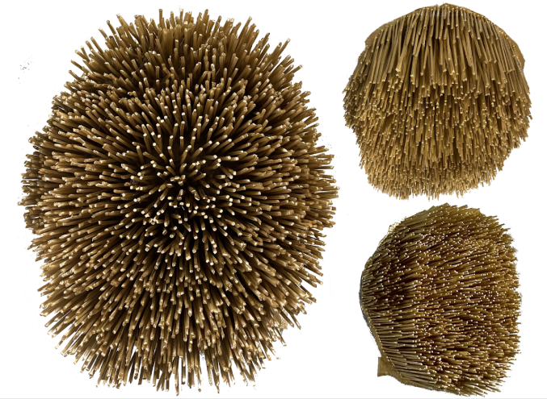
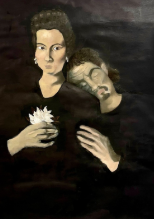
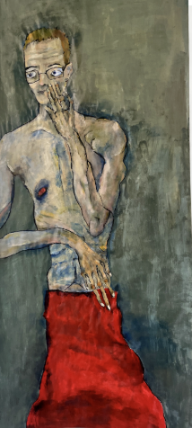

<!DOCTYPE html>
<html lang="en">
<head>
  <meta charset="utf-8">
  <meta name="viewport" content="width=device-width, initial-scale=1">
  <title>Edeline Ohk</title>

  
</head>

<body>
  

    <header class="header">
      <h1>Edeline Ohk</h1>

      <nav class="nav" role="tablist" aria-label="Website sections">
        <button
          type="button"
          class="nav-btn"
          id="tab-about"
          role="tab"
          data-section="about"
          aria-controls="about"
          aria-selected="true"
        >About</button>

        <button
          type="button"
          class="nav-btn"
          id="tab-projects"
          role="tab"
          data-section="projects"
          aria-controls="projects"
          aria-selected="false"
          tabindex="-1"
        >Projects</button>

        <button
          type="button"
          class="nav-btn"
          id="tab-resume"
          role="tab"
          data-section="resume"
          aria-controls="resume"
          aria-selected="false"
          tabindex="-1"
        >Resume</button>
      </nav>
    </header>

    <main>
      <section
        class="section"
        id="about"
        role="tabpanel"
        aria-labelledby="tab-about"
        tabindex="0"
      >
        <h2>Hi, I’m Edeline!</h2>

        

          I study Politics and International Affairs at the University
          of Melbourne. Before university, I worked for the Australian
          Government in Canberra and Washington, D.C., across public
          administration, trade and economic security.
        

        

          I’m especially interested in how Australia navigates the
          international questions shaping our time, from supply security
          in a new technological and climate era to migration, borders
          and sovereignty. Currently, when I’m not doing school work,
          I enjoy some creative labour and local history. Here you’ll
          find some of my projects and my resume. Thanks for stopping by!
        

        

          <a
            href="https://www.linkedin.com/in/edeline-ohk111"
            target="_blank"
            rel="noopener noreferrer"
          >LinkedIn</a>

          <a href="mailto:ohkedeline@gmail.com">Email</a>
        

      </section>

      <section
        class="section"
        id="projects"
        role="tabpanel"
        aria-labelledby="tab-projects"
        tabindex="0"
        hidden
      >
        <h2>Projects</h2>

        <article class="project-card">
          <h3>Returning to university life</h3>
          
2027 – Ongoing

          

            Returning to university after full-time work has been an
            adjustment. I had forgotten, among other things, that 10AM
            can constitute an early start! Still, university has left me
            with the luxury of a little more time, which I have been
            filling with various projects, questionable commitments,
            and the occasional attempt at becoming a well-rounded person.
            Here is what I have been getting up to.
          

          

            
Read more

            

              <h4>
                Marketing Director, University of Melbourne Matcha Club
              </h4>

              

                The club’s Instagram has grown from zero to more than
                1,000 followers, alongside a community of over 300 members.
                What drew me in, though, was its hilariously unserious
                premise of bringing people together over a drink they love.
                An entire club whose entire ideological programme amounts
                to having a nice free drink felt like a great counterweight
                to a politics degree (satirical).
              

              <h4>
                Events Officer, Young Australians in International Affairs
                (YAIYA)
              </h4>

              

                I have also taken on an Events Officer role. Australia’s
                voice matters, and I want to understand more clearly what
                we ought to do with it. The role gives me the chance to
                bring together people thinking about the same questions,
                while surrounding myself with peers who care just as much
                about international affairs and what Australia can
                contribute to them.
              

              <h4>Neighbourhood dog walking</h4>

              

                Solomon, a Chihuahua–Jack Russell mix, and Maggie, an
                Australian Cattle Dog mix, keep me company on our
                twice-weekly, hour-long walks. They bring affection,
                enthusiasm and a rigorous peer-review process to every
                tree. Their priorities are admirably clear, and their
                approach to networking considerably more direct than mine.
              

              <h4>Volunteer English Tutor, Embrace Education</h4>

              

                With a little more time on my hands, I also wanted to
                use some of it to give back to the community around me.
              

            

          

        </article>

        <article class="project-card">
          <h3>Art portfolio</h3>
          
2021 – onwards

          

            A digital showroom of curiosities for my visual projects,
            from paintings and sketches to sculptures and photographs.
            Entirely for fun.
          

          

            
View artworks

            

              <figure>
                

                <figcaption>
                  Inspired by Rosalie Gascoigne, I used chopsticks to
                  evoke the form of a Korean ancestral gravesite, or
                  <em>sanso</em> (산소).
                </figcaption>
              </figure>

              <figure>
                

                <figcaption>
                  Painted Caravaggio alongside Fillide Melandroni,
                  one of his favourite muses.
                </figcaption>
              </figure>

              <figure>
                

                <figcaption>
                  Large portraiture of a politician (produced for class)
                  in the style of Egon Schiele.
                </figcaption>
              </figure>
            

          

        </article>
      </section>

      <section
        class="section"
        id="resume"
        role="tabpanel"
        aria-labelledby="tab-resume"
        tabindex="0"
        hidden
      >
        <h2>Resume</h2>

        

          I have some experience across government, international affairs,
          research and public administration.
        

        

          <a
            href="resume%20(3).pdf"
            target="_blank"
            rel="noopener noreferrer"
          >View resume</a>

          <a
            href="resume%20(3).pdf"
            download="Edeline-Ohk-Resume.pdf"
          >Download resume</a>
        

        <iframe
          class="resume-preview"
          src="resume%20(3).pdf#view=FitH"
          title="Edeline Ohk’s resume"
          loading="lazy"
        ></iframe>
      </section>
    </main>
  

  
</body>
</html>
